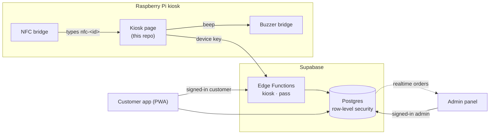

# RAISE: self-checkout on a Raspberry Pi

RAISE is a smart self-checkout kiosk. Shoppers log in with a QR pass or an NFC card, scan their own items with a cheap USB webcam, and pay by UPI. Their points and receipts show up on their phone. The store manages products, orders, customers and kiosks from a live admin panel.

| | Link |
|---|---|
| Kiosk | https://raise.bindalvansh01.workers.dev/ |
| Customer app (installable PWA) | https://raise.bindalvansh01.workers.dev/app/ |
| Admin panel | https://raise.bindalvansh01.workers.dev/admin/ |
| Backend, admin and app source | [Hacklab-Team/raise-cloud](https://github.com/Hacklab-Team/raise-cloud) |

This repo is the **kiosk**, plus the Raspberry Pi setup scripts and the built admin panel and customer app that the site serves. Their source code lives in **[raise-cloud](https://github.com/Hacklab-Team/raise-cloud)** with the database and server functions.

## A shopper's walk-through

1. **Walk up.** The kiosk shows an attract screen. Touch it to start.
2. **Log in** with any of these:
   - hold up your RAISE Pass QR (on a phone or printed);
   - tap your NFC card;
   - register on the spot with a name and mobile, and get a pass to print or save;
   - continue as a guest.
3. **Scan items** at the webcam, or with a phone paired as a Bluetooth barcode scanner. The buzzer beeps on every scan, and the bill updates live.
4. **Pay** by scanning the UPI QR. The order is saved to the cloud and points are added (1 point per ₹10).
5. **Afterwards**, in the RAISE app, the shopper sees the receipt, their points and their pass. Someone who registered at the kiosk can claim that pass in the app: tap your name on the kiosk to show the QR, then in the app go to Account → Claim a kiosk pass.

## Hardware

| Part | Job |
|---|---|
| Raspberry Pi (Pi OS, Chromium in kiosk mode) | Runs the kiosk full screen, boots straight into it |
| USB webcam | Reads pass QRs and product barcodes |
| PN532 NFC reader (I2C) | Card login; the RC522 also works |
| GPIO buzzer | Beeps for login, scans and payment, with adjustable volume |
| Phone as a Bluetooth HID scanner | Optional faster barcode scanning; it types like a keyboard |

## Engineering highlights

- **Reading barcodes from a bad webcam.** Frames are decoded in a Web Worker by two WebAssembly decoders, ZXing and ZBar, rotating through plain and contrast-enhanced images ([`scanner.js`](scanner.js)). When the image is too blurry for any decoder, [`barcode-match.js`](barcode-match.js) compares the bar pattern against every catalog item instead of reading individual bars. On a real webcam frame no decoder could read, the right product scored 0.91 against 0.63 for the next best. A match must also repeat on two frames before anything is added.
- **Hardware without browser permissions.** The NFC and barcode readers act as keyboards. [`kiosk/nfc-bridge.py`](kiosk/nfc-bridge.py) reads the card and types `nfc-<id>` through `uinput`, so the page needs no USB or serial access. The buzzer is a tiny localhost HTTP bridge ([`kiosk/buzzer-bridge.py`](kiosk/buzzer-bridge.py)).
- **Passes that can't be forged.** The pass QR is `RAISE2.<pass id>.<signature>`, signed on the server with a secret the kiosk never sees. It carries no name, phone number or balance, so a printed pass never goes stale.
- **Privacy.** NFC card IDs are stored only as a SHA-256 hash. Kiosks authenticate with a device key, and the database keeps only its hash.
- **Server-side prices.** At checkout the server prices every item from the database, so a tampered kiosk can't change what you pay. Barcodes that aren't in the catalog are looked up on Open Food Facts and clearly marked as estimated prices.
- **Keeps working on a flaky network.** A service worker caches the kiosk. If the cloud is unreachable, card login falls back to cards linked on that kiosk.
- **One-command Pi setup.** [`kiosk/setup-kiosk.sh`](kiosk/setup-kiosk.sh) sets up auto-login, no screen blanking, a Chromium kiosk with the camera pre-approved, and autostart on labwc, Wayfire or X11. There are matching scripts for NFC and the buzzer, plus [`kiosk/raise-diag.sh`](kiosk/raise-diag.sh) for troubleshooting.

## How it fits together



## What's in this repo

```
index.html          kiosk app (stages: pass → scan → pay → paid, plus register and link a card)
scanner.js          camera + decoder scheduling;  scan-worker.js  decoding in a Web Worker
barcode-match.js    blur-tolerant EAN matcher against the catalog
catalog.js          catalog (cloud first) + Open Food Facts lookup for unknown barcodes
cloud.js            talks to the RAISE Cloud kiosk API;  cloud-config.js  public project URL + key
pass.js             older offline passes (RAISE1) for kiosks with no cloud
shared.js           icons, toasts, theme, buzzer
sw.js               service worker (offline cache)
kiosk/              Raspberry Pi setup, NFC and buzzer bridges, diagnostics (see kiosk/README.md)
admin/  app/        built admin panel and customer app (source in raise-cloud)
vendor/             ZXing and ZBar WebAssembly decoders, QR generator
```

## Run it

- **On a Pi:** follow [`kiosk/README.md`](kiosk/README.md). In short, run `bash setup-kiosk.sh https://raise.bindalvansh01.workers.dev/`, then open the kiosk setup link from the admin panel (Kiosks → Add kiosk) once.
- **On a laptop:** run `python3 -m http.server 8080` in this folder and open `http://localhost:8080`. The camera needs `localhost` or https. Without a kiosk key it runs in offline demo mode.

## Honest limits

- **Payment is simulated.** The UPI QR is real, but no payment gateway is connected, so a "Demo: mark as paid" button confirms the payment.
- **Demo prices.** Catalog barcodes and images are real (Open Food Facts); prices are this demo store's own list.
- **Next step:** a load cell under the bagging area, so the kiosk can check that what goes in the bag matches what was scanned.
